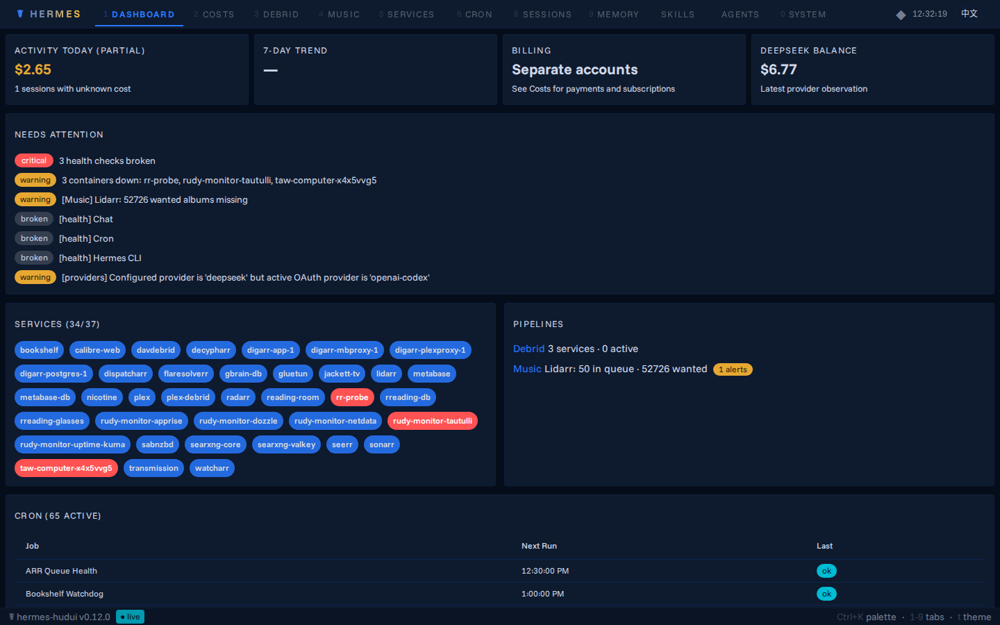
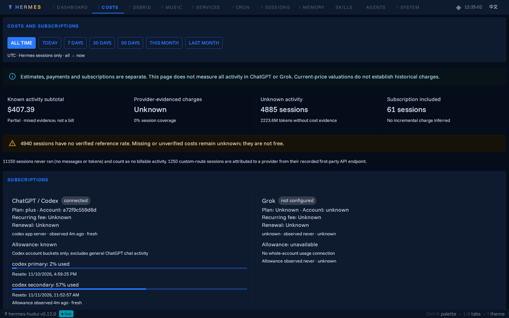
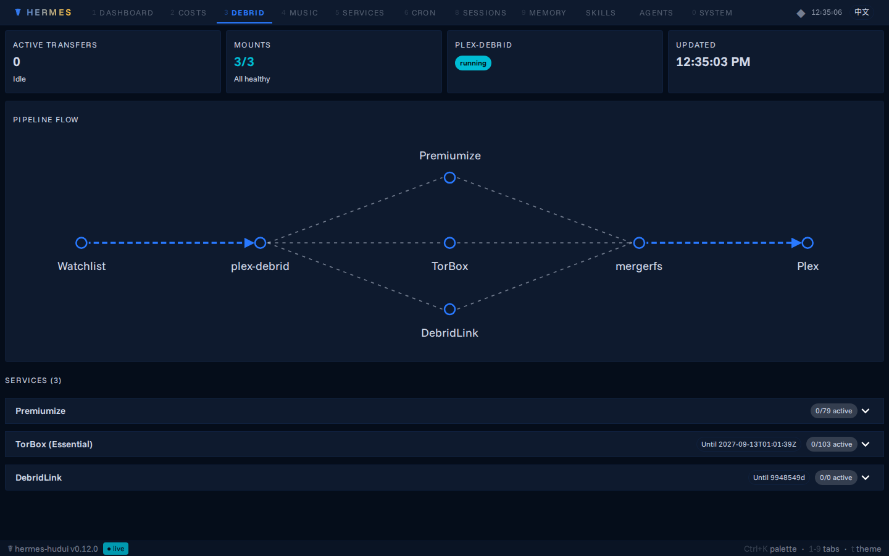
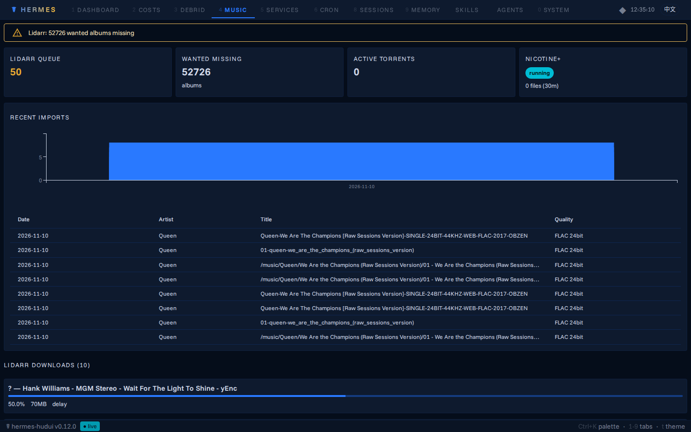
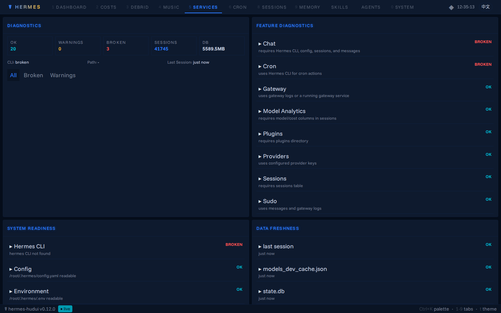
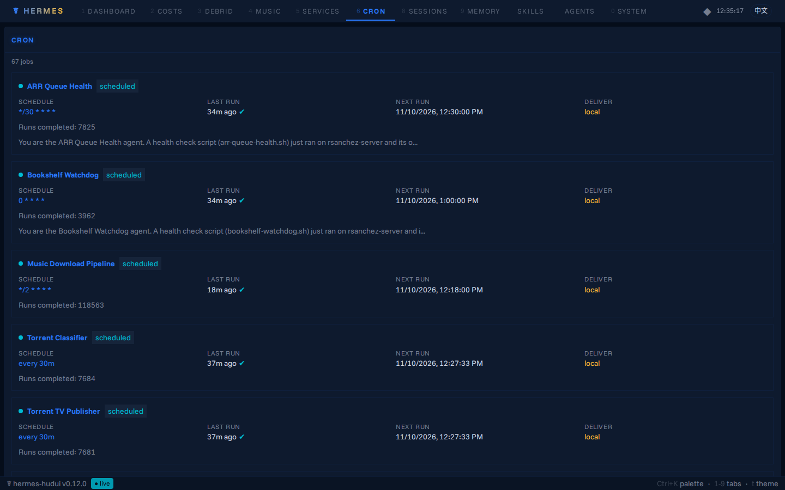
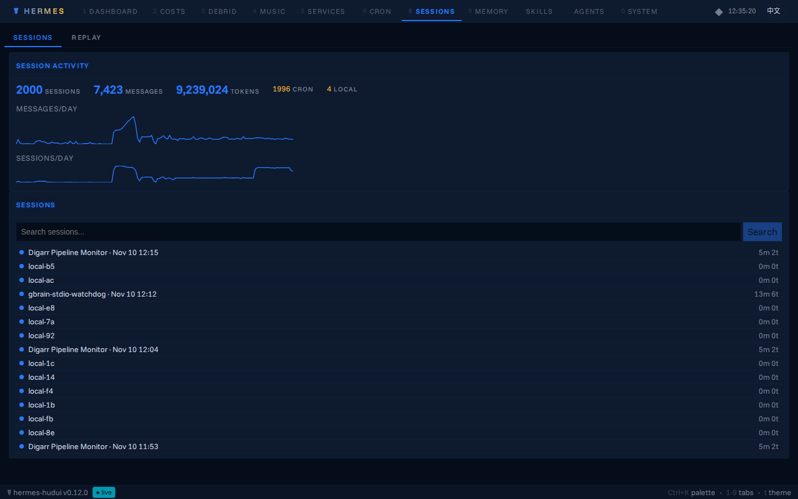
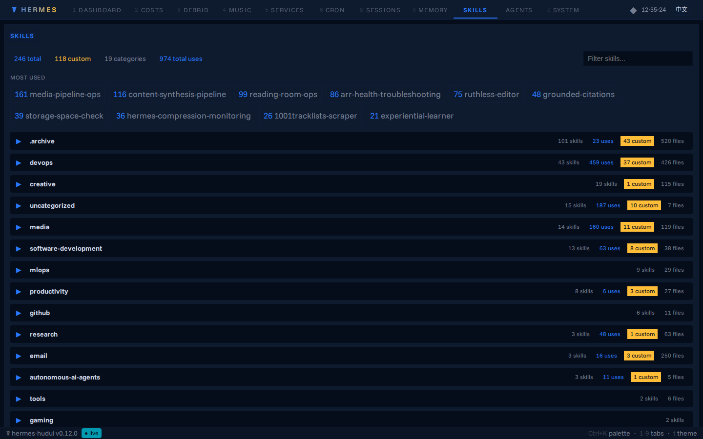

# ☤ Hermes HUD — Web Consciousness Monitor

A browser-based consciousness monitor, telemetry console, and pipeline observer for [Hermes Agent](https://github.com/nousresearch/hermes-agent).

[](CHANGELOG.md)
[](frontend/)
[](backend/)
[](LICENSE)



Hermes HUD provides deep, real-time observability into an active Hermes agent's memory, sessions, cost analytics, automated cron jobs, and background pipeline infrastructure.

Originally developed as a local dashboard, this version reflects the **v0.10–v0.12 architecture**: consolidated into an 11-tab Material-UI v9 single-page application with read-only v2 security, hybrid SQLite data replication, and real-time pipeline monitoring.

---

## 🧭 The 11-Tab Interface

The interface consolidates 18 legacy panels into 11 streamlined surfaces with responsive tab navigation, mobile drawer support, keyboard shortcuts (`1`–`9`, `0`), and five themes (including *Hermes Teal*, *Neural Awakening*, and *fsociety*).

| Surface | Tab ID | What it monitors |
|---|---|---|
| **Executive Dashboard** | `dashboard` | Ops console: token spend pulse, unified **Needs Attention** feed, top model usage, and live services status. |
| **Costs & Subscriptions v2** | `token-costs` | Exact provider/model pricing matching, canonical cache & reasoning token accounting, live provider balances, and subscription allowances. |
| **Debrid Pipeline** | `debrid` | Real-time cloud debrid status (Premiumize, TorBox, DebridLink) with interactive D3 pipeline flow diagrams. |
| **Music Pipeline** | `music` | Media acquisition tracking across Lidarr queues, Transmission torrents, and Nicotine+ Soulseek transfers with import history charts. |
| **Services & Health** | `services` | Live health diagnostics, systemd daemons, background watchers, and container fleet health. |
| **Cron Scheduling** | `cron` | Active Hermes scheduled jobs, timers, execution history, and error logs. |
| **Sessions & Replay** | `sessions` | Deep session inspection with normalized timelines and **Hermes Replay** (redacted, shareable proof artifacts). |
| **Memory & Corrections** | `memory` | Long-term episodic memory pages, user profile facts, and behavioral correction rules. |
| **Skills Registry** | `skills` | Agent skill catalog with category breakdown, usage counts, and drill-down inspection modals. |
| **Agent Subsystems** | `agents` | Multi-agent session trees, model routing, and subagent delegation status. |
| **System Diagnostics** | `system` | Host resource utilization, gateway managed tools, and runtime configurations. |

---

## 📸 Real-Time Screenshots

| Executive Dashboard | Costs & Subscriptions v2 |
|:---:|:---:|
|  |  |

| Debrid Pipeline (D3 Flow) | Music Pipeline (Lidarr / Soulseek) |
|:---:|:---:|
|  |  |

| Services & Container Grid | Cron Scheduler (65 Active Jobs) |
|:---:|:---:|
|  |  |

| Sessions & Replay | Skills Catalog & Usage Metrics |
|:---:|:---:|
|  |  |

---

## 🏛️ Architecture & Deployment

Hermes HUD is designed to run in two primary modes:

### 1. Local Machine Mode
Runs directly on the host alongside the agent daemon:
- Reads state directly from `~/.hermes/` (`state.db`, `config.yaml`, session JSONL transcripts).
- Broadcasts real-time filesystem updates over WebSockets.

### 2. Cloud VPS / Remote Production Mode (`hermeshud.com`)
To prevent heavy analytics queries and full-table scans from consuming host resources, production deployments use the **hybrid remote architecture**:

```
Browser → https://hermeshud.com
    │
    ▼
Cloudflare Access (Zero Trust PIN authentication)
    │
    ▼
Cloudflare Tunnel (cloudflared)
    │
    ▼
DigitalOcean VPS (FastAPI + Built React Static Assets)
    ├── /root/.hermes/          ← Local hybrid replica
    ├── /root/.hermes-mnt/      ← Read-only sshfs mount of server ~/.hermes
    └── Hourly hermes-sync      ← Consistent SQLite backup API snapshot + hot directories
```

- **Read-Only v2 Posture:** All write-capable routes (`POST`, `PUT`, `DELETE`, `PATCH`) are stripped from the API, and a global ASGI middleware enforces `405 Method Not Allowed` on any mutation.
- **Event-Loop Protection:** Filesystem watchers are bypassed (`HUD_NO_WATCH=1`) over network mounts to eliminate event-loop starvation.
- **Optimized Analytical Queries:** Sub-second response times via single-flight caching, covering indexes (`idx_hud_*`), and capped session detail scans.

---

## 🚀 Quick Start

### Prerequisites
- Python 3.11+
- Node.js 18+ (for building frontend)
- A running Hermes agent or `~/.hermes/` data directory

### Setup

```bash
git clone https://github.com/rudysanchez-mfb/hermes-hud.git
cd hermes-hud
./install.sh
hermes-hudui
```

Open `http://localhost:3001` in your browser.

On future runs:
```bash
source venv/bin/activate
hermes-hudui
```

---

## 🔒 Hermes Replay & Safe Share

Hermes Replay turns agent runs into redacted, shareable proof artifacts:
- Normalized execution timelines with per-tool execution telemetry.
- **Safe Share Mode:** Automatically redacts raw tool arguments, terminal stdout, assistant reasoning traces, API tokens, local paths, and email addresses.
- Exports to standalone HTML, Markdown, or JSON.

---

## 📄 License

MIT License — see [LICENSE](LICENSE) and [NOTICE](NOTICE) for details.
